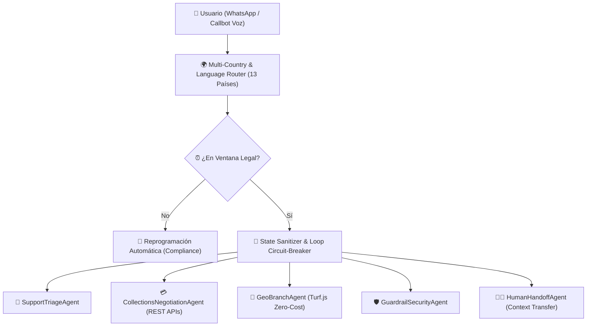

# 🚀 AgentOps Studio — Multi-Country Conversational AI Router, Geo-Locator & QA Suite

Plataforma de orquestación, ruteo multi-país (**13 países de Latinoamérica**), geolocalización de costo cero con **Turf.js** y suite automatizada de **30 casos de QA pre-producción** para agentes de IA conversacional (**Chatbots en WhatsApp & Callbots de Voz**).

Desarrollado por **Agustín Luján** — *IA Agent Developer*.

---

## 🎯 Problemas Reales que Resuelve

1. **Ruteo Multi-país (13 países) y Multilingüe (`ES`/`PT`) con Sanitización Anti-Loop (`src/engine/router.js`):**
   - En arquitecturas multi-agente donde el usuario cambia de idioma a mitad de la conversación, un flag transitorio (`pendingLanguageSwitch`) no reseteado entre handoffs puede provocar un loop infinito de derivaciones.
   - `sanitizeHandoffState()` limpia explícitamente las variables transitorias antes de transferir el contexto al sub-agente e incluye un *circuit-breaker* de seguridad (`MAX_HANDOFF_HOPS = 3`).
   - Valida automáticamente la **ventana horaria legal de contacto** y registros locales (*No Llame*, *ANATEL Não Me Perturbe*, *Ley 2300 Colombia*, *REUS México*, etc.).

2. **Buscador de Sucursales Geolocalizado con `Turf.js` a Costo $0 de API Externa (`src/engine/geolocator.js`):**
   - Calcula distancias geodésicas (`turf.distance`) directamente en memoria dentro de las acciones de código (*Code Actions*) sobre un catálogo JSON de sucursales.
   - Elimina el costo por request de APIs externas de mapas (Google Maps / Mapbox), reduce la latencia a `< 2ms` y genera el payload estructurado de **WhatsApp Interactive Lists**.

3. **Batería Automatizada de 30 Casos de QA Pre-Producción (`src/qa/qaRunner.js`):**
   - Ejecuta 30 pruebas de regresión sobre 5 dimensiones críticas antes de publicar cualquier cambio de prompt o regla de negocio:
     - *Ruteo & Anti-Loop (6 casos)*
     - *Geolocalización Turf.js (6 casos)*
     - *Negociación, Quitas & Promesas de Pago por API REST (6 casos)*
     - *Guardrails contra Prompt Injection & Ventana Legal (6 casos)*
     - *Handoff a Humano con Transferencia de Contexto & Cobertura en 13 Países (6 casos)*

---

## 🏗️ Arquitectura del Sistema (Mermaid.js)



---

## ⚡ Instalación y Ejecución Rápida

```bash
# 1. Instalar dependencias (@turf/turf y express)
npm install

# 2. Correr la batería de 30 casos de QA por consola
npm run test:qa

# 3. Levantar el Dashboard interactivo en http://localhost:3000
npm start
```
